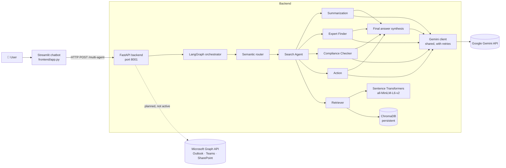

# Enterprise Intelligent Knowledge Assistant

> An AI copilot that answers questions about your company's documents — with sources — using
> Retrieval-Augmented Generation (RAG), Google Gemini and five specialized AI agents that are
> selected automatically for every question.


---

## Table of contents

1. [Overview](#overview)
2. [Problem statement](#problem-statement)
3. [Solution overview](#solution-overview)
4. [Key features](#key-features)
5. [System architecture](#system-architecture)
6. [RAG pipeline](#rag-pipeline)
7. [The five AI agents](#the-five-ai-agents)
8. [Automatic multi-agent orchestration](#automatic-multi-agent-orchestration)
9. [Microsoft 365 integration readiness](#microsoft-365-integration-readiness)
10. [Technology stack](#technology-stack)
11. [Project structure](#project-structure)
12. [Installation](#installation)
13. [Configuration](#configuration)
14. [Running the application](#running-the-application)
15. [API documentation](#api-documentation)
16. [Testing](#testing)
17. [Future improvements](#future-improvements)

---

## Overview

**Enterprise AI Copilot** is a chat assistant for enterprise knowledge. Employees ask questions in
plain language — *"How was the last server outage resolved?"*, *"Who should I contact about the
travel policy?"*, *"Can I book a business-class flight?"* — and get a concise answer that is
**grounded only in the organization's own documents**, with the source file and page number for
every fact.

Behind a single chat box, the backend decides which specialist agents a question needs (search,
summarization, expert finding, compliance checking, action planning), runs only those, and merges
their findings into one answer.

## Problem statement

Enterprise knowledge is scattered across policies, incident reports, tickets, wikis and emails.
Finding the right answer means knowing *where* to look and *who* to ask. Generic chatbots don't know
company documents and tend to invent plausible-sounding answers, which is unacceptable for policy
or compliance questions.

## Solution overview

- **Retrieval-Augmented Generation:** documents are split into chunks, embedded and stored in a
  vector database. For each question the most relevant passages are retrieved by meaning (not
  keywords) and given to Gemini with strict instructions to answer **only** from them.
- **Honest by design:** if the documents don't contain the answer, the assistant says so instead of
  guessing. If Gemini fails, the error is reported — never replaced by a made-up answer.
- **Specialist agents:** five agents handle different kinds of requests; a semantic router picks the
  relevant ones automatically, and a final synthesis step produces one coherent, de-duplicated answer.
- **Enterprise-ready architecture:** connector interfaces for Microsoft Outlook, Teams and SharePoint
  (via Microsoft Graph API) are prepared for a future stage.

## Key features

| Feature | Details |
|---|---|
| 📄 Document ingestion | PDF, DOCX and TXT upload with size/type validation and page tracking |
| 🧩 Smart chunking | Fixed-size chunks with overlap; chunks never span two pages |
| 🔎 Semantic search | Sentence Transformers embeddings + ChromaDB cosine similarity |
| 🤖 Grounded answers | Gemini answers only from retrieved context, with `[n]` citations |
| 🧠 Five AI agents | Search, Summarization, Expert Finder, Compliance Checker, Action |
| 🧭 Automatic routing | Embedding-based intent detection; multiple agents for multi-part questions |
| 🧾 Source citations | File name + page number for every answer, evidence on demand |
| ♻️ Duplicate-safe indexing | Same file re-uploaded = no-op; changed file = clean replacement |
| 🛡️ Reliability | Retries for temporary Gemini errors (429/503/504), partial-failure reporting |
| 💸 Token-efficient | 1 Gemini call for single-agent questions, capped context and output |
| 💬 Premium chat UI | Single-screen Streamlit chatbot, dark navy theme |
| 🔌 Microsoft 365 ready | Outlook / Teams / SharePoint connector placeholders (not yet connected) |

## System architecture



A detailed walkthrough of every flow is in **[docs/architecture.md](docs/architecture.md)**.

## RAG pipeline

### 1. Document ingestion & text extraction
`POST /documents/upload` accepts **PDF** (`pypdf`, page by page), **DOCX** (`python-docx`,
paragraphs + tables) and **TXT** (UTF-8 with a Latin-1 fallback). Empty, corrupt and unsupported
files are rejected with clear errors (400/413/415/422).

### 2. Chunking strategy — fixed-size chunking with overlap
- Text is split into chunks of **1,000 characters** with a **200-character overlap** (both configurable).
- Boundaries are moved to the nearest whitespace so words are never cut in half.
- Chunking happens **per page**, so every chunk keeps an exact page number.
- The overlap keeps sentences that straddle a boundary retrievable from either side.

### 3. Embeddings and ChromaDB storage
- Every chunk is embedded with **`sentence-transformers/all-MiniLM-L6-v2`** (384-dimensional,
  normalized vectors). The model is loaded once and reused.
- Chunks, vectors and metadata (`source`, `page`, `chunk_index`, `content_hash`) are stored in a
  **persistent ChromaDB** collection using cosine distance.
- **Duplicate handling:** documents are identified by filename with stable chunk IDs
  (`filename::index`). A SHA-256 content hash makes identical re-uploads a no-op and replaces
  stale chunks when a file changes.

### 4. Semantic retrieval
The question is embedded with the **same** model and ChromaDB returns the nearest chunks
(default **top 3**). Chunks with a cosine distance above **0.9** are discarded as irrelevant.
Because matching is by meaning, *"Why did employees lose access to the order system?"* finds the
passage about an *"expired TLS certificate on a load balancer"*.

### 5. Gemini-powered answer generation
Retrieved passages are numbered and sent to **Gemini** (`gemini-3.1-flash-lite` by default, configurable)
with strict rules: use only the context, cite passages as `[1]`, `[2]`, and reply with an
*insufficient context* marker when the answer isn't there. The cited passages become the response's
`sources`, so every listed source actually backs the answer.

## The five AI agents

All agents live in `backend/app/agents/` and share the same retriever, embedding model and Gemini client.

| Agent | What it does | Gemini? |
|---|---|---|
| 🔎 **Search Agent** | Runs semantic retrieval and returns evidence (text, file, page, relevance). Always runs first; its evidence is shared with the others. | No |
| 📝 **Summarization Agent** | Produces concise, cited summaries of the requested topic. Says so if the topic isn't covered instead of summarizing something else. | Yes |
| 👥 **Expert Finder Agent** | Identifies people by role, responsibility and involvement **named in the documents**, with contact details only if present. Never invents people; notes that no employee directory exists. | Yes |
| 🛡️ **Compliance Checker Agent** | Retrieves relevant policies, lists the applicable requirements with citations and states whether a situation looks compliant — with a "not legal advice" disclaimer. | Yes |
| ⚡ **Action Agent** | Recommends next steps based on the evidence and other agents' findings; includes owners and deadlines **only** when the documents state them. Never executes actions. | Yes |

## Automatic multi-agent orchestration

The user never chooses an agent. Every question goes to **`POST /multi-agent`**, implemented as a
**LangGraph** state graph:

```
START → route → search → [selected specialists, fixed order] → synthesize → END
```

1. **Semantic routing** — each agent is described by example requests ("Who can help me with this
   problem?", "Is this allowed under company policy?", …). The question **and each of its clauses**
   are embedded and compared with those examples. An agent is selected when its similarity is
   ≥ 0.35 and within 0.08 of the best match for that clause, so *"Who should I contact about the
   travel policy, **and** do expenses need approval?"* selects both Expert Finder and Compliance.
   If no specialist is confident, the **Search Agent alone** answers (safe fallback). The response
   includes routing scores and reasons.
2. **Execution** — only the selected agents run; the Action Agent runs last so it can build on the others.
3. **Synthesis** — with one successful agent, its answer *is* the final answer (no extra LLM call).
   With several, one Gemini call merges them into a single de-duplicated answer, using only the
   passages the agents actually cited.
4. **Honest status** — `status` is `complete`, `partial` (some agents failed) or `failed`, with
   per-agent `success` and `error` fields.

## Microsoft 365 integration readiness

> ⚠️ **These integrations are prepared placeholders, not live connections.** No Microsoft account is
> connected, no authentication is performed, no Graph API request is sent, and no Outlook, Teams or
> SharePoint data is used in answers.

Connector modules live in `backend/app/integrations/microsoft/` and use **Microsoft Graph API** as the
planned integration layer:

| Connector | Purpose | Placeholder operations | Status |
|---|---|---|---|
| **Outlook** | Search enterprise email | `search_messages`, `get_message`, `get_conversation` | Integration Ready |
| **Teams** | Search team conversations | `list_channels`, `search_messages`, `get_thread` | Coming Soon* |
| **SharePoint** | Access document repositories | `search_files`, `list_site_documents`, `download_file` | Integration Ready |

\* Reading Teams channel messages with application permissions uses a Microsoft **protected API**
that requires separate approval from Microsoft.

Every operation raises `ConnectorNotImplementedError`. Each connector also exposes a `search()` hook
designed to return results in the same shape as ChromaDB evidence, so it can later feed the Search
Agent — it is **not** wired into the agents today. `GET /integrations` reports each connector's real
status (`authenticated: false`, `live_data_enabled: false`), and the chatbot shows it in a collapsed
*Enterprise Integrations* panel.

**Required for a real integration:** an Entra ID (Azure AD) app registration (client ID, tenant ID,
client secret), admin consent for `Mail.Read`, `User.Read.All`, `Sites.Read.All`, `Files.Read.All`,
`Team.ReadBasic.All`, `Channel.ReadBasic.All`, `ChannelMessage.Read.All`, and token acquisition via
MSAL (client-credentials flow).

## Technology stack

| Layer | Technology |
|---|---|
| Language | Python 3.13 |
| Backend API | FastAPI, Uvicorn, Pydantic / pydantic-settings |
| Orchestration | LangGraph |
| LLM | Google Gemini via the official `google-genai` SDK |
| Embeddings | Sentence Transformers (`all-MiniLM-L6-v2`) |
| Vector database | ChromaDB (persistent, cosine distance) |
| Document parsing | pypdf, python-docx |
| Frontend | Streamlit + requests |
| Testing | pytest, FastAPI TestClient, Streamlit AppTest |
| Planned integration | Microsoft Graph API |

## Project structure

```
enterprise-knowledge-assistant/
├── backend/
│   ├── app/
│   │   ├── main.py                  # FastAPI app, CORS, error handler, routers
│   │   ├── config.py                # Central settings (reads backend/.env)
│   │   ├── schemas.py               # Request/response models
│   │   ├── api/                     # HTTP endpoints
│   │   │   ├── documents.py         #   GET /documents, POST /documents/upload
│   │   │   ├── rag.py               #   POST /rag/retrieve
│   │   │   ├── chat.py              #   POST /chat
│   │   │   ├── multi_agent.py       #   POST /multi-agent
│   │   │   └── integrations.py      #   GET /integrations
│   │   ├── services/                # RAG pipeline building blocks
│   │   │   ├── document_loader.py   #   PDF/DOCX/TXT text extraction
│   │   │   ├── chunker.py           #   fixed-size chunking with overlap
│   │   │   ├── embeddings.py        #   Sentence Transformers (loaded once)
│   │   │   ├── vector_store.py      #   ChromaDB persistence + duplicate handling
│   │   │   ├── indexer.py           #   load → chunk → embed → store
│   │   │   ├── retriever.py         #   semantic retrieval
│   │   │   ├── llm.py               #   shared Gemini client (retries, token cap)
│   │   │   └── answer_generator.py  #   grounded answers for /chat
│   │   ├── agents/                  # Five agents + orchestration
│   │   │   ├── search_agent.py
│   │   │   ├── summarization_agent.py
│   │   │   ├── expert_finder_agent.py
│   │   │   ├── compliance_agent.py
│   │   │   ├── action_agent.py
│   │   │   ├── router.py            #   semantic agent routing
│   │   │   ├── orchestrator.py      #   LangGraph graph + synthesis
│   │   │   └── common.py            #   shared agent helpers
│   │   └── integrations/microsoft/  # Graph API connector placeholders
│   │       ├── config.py            #   MICROSOFT_* settings
│   │       ├── base.py              #   connector interface
│   │       ├── outlook.py
│   │       ├── teams.py
│   │       └── sharepoint.py
│   ├── tests/                       # 136 automated tests (Gemini mocked)
│   ├── requirements.txt
│   ├── pytest.ini
│   ├── .env.example
│   └── README.md                    # Backend-specific notes
├── frontend/
│   ├── app.py                       # Enterprise AI Copilot chatbot (Streamlit)
│   ├── requirements.txt
│   └── .env.example
├── docs/
│   └── architecture.md              # Detailed architecture and data flows
├── .gitignore
└── README.md
```

## Installation

**Prerequisites:** Python 3.13 (3.12 also works), Git, a Google Gemini API key
([Google AI Studio](https://aistudio.google.com/)).

```powershell
git clone <your-repo-url>
cd enterprise-knowledge-assistant

# Backend environment
cd backend
py -3.13 -m venv .venv            # macOS/Linux: python3 -m venv .venv
.\.venv\Scripts\Activate.ps1      # macOS/Linux: source .venv/bin/activate
pip install -r requirements.txt   # includes PyTorch for embeddings (large download)
cd ..

# Frontend environment (kept separate)
py -3.13 -m venv frontend\.venv
frontend\.venv\Scripts\python.exe -m pip install -r frontend\requirements.txt
```

## Configuration

Copy the templates and fill in your own values. **Never commit `.env` files.**

```powershell
Copy-Item backend\.env.example backend\.env
Copy-Item frontend\.env.example frontend\.env   # optional, only to change the backend URL
```

| Variable | File | Purpose |
|---|---|---|
| `GEMINI_API_KEY` | backend/.env | **Required** for answers. Stays on the backend only. |
| `GEMINI_MODEL` | backend/.env | Gemini model, default `gemini-3.1-flash-lite` |
| `GEMINI_MAX_OUTPUT_TOKENS`, `GEMINI_MAX_RETRIES` | backend/.env | Cost and reliability limits |
| `EMBEDDING_MODEL` | backend/.env | Sentence Transformers model |
| `CHROMA_PERSIST_DIR`, `CHROMA_COLLECTION_NAME` | backend/.env | Vector store location and collection |
| `CHUNK_SIZE`, `CHUNK_OVERLAP` | backend/.env | Chunking strategy (characters) |
| `DEFAULT_TOP_K`, `MAX_UPLOAD_SIZE_MB` | backend/.env | Retrieval and upload limits |
| `CORS_ORIGINS` | backend/.env | Browser origins allowed to call the API |
| `MICROSOFT_CLIENT_ID`, `MICROSOFT_CLIENT_SECRET`, `MICROSOFT_TENANT_ID`, `MICROSOFT_GRAPH_BASE_URL` | backend/.env | Optional placeholders for future Microsoft Graph integration — not required |
| `BACKEND_URL` | frontend/.env | Backend address, default `http://127.0.0.1:8001` |

## Running the application

**1. Start the backend** (from `backend/`):

```powershell
.\.venv\Scripts\python.exe -m uvicorn app.main:app --port 8001
```

**2. Start the frontend** (from the project root, in a second terminal):

```powershell
frontend\.venv\Scripts\python.exe -m streamlit run frontend/app.py --server.port 8501
```

Open **http://localhost:8501** and ask a question.

**3. Add documents.** The chatbot is intentionally upload-free. Index documents through the API, e.g.
in Swagger (`POST /documents/upload`) or:

```powershell
curl.exe -F "file=@path\to\document.pdf" http://127.0.0.1:8001/documents/upload
```

## API documentation

With the backend running, interactive Swagger docs are at **http://127.0.0.1:8001/docs**
(ReDoc at `/redoc`).

| Method | Endpoint | Description |
|---|---|---|
| GET | `/health` | Status, whether Gemini is configured, model name |
| GET | `/documents` | Indexed documents with chunk counts and pages |
| POST | `/documents/upload` | Upload and index a PDF/DOCX/TXT (multipart field `file`) |
| POST | `/rag/retrieve` | Semantic search only (no LLM): `{"question": "...", "top_k": 3}` |
| POST | `/chat` | Grounded single-step RAG answer with sources and evidence |
| POST | `/multi-agent` | Automatic agent routing + synthesized answer (used by the chatbot) |
| GET | `/integrations` | Microsoft connector status (read-only, no secrets) |

Example:

```json
POST /multi-agent
{ "question": "How was the server outage resolved and what follow-up actions were recommended?" }
```

returns `final_answer`, `sources` (filename + page), `selected_agents`, `routing` (scores and reasons),
`agent_results` (per-agent output, evidence, errors), `status` and `usage` (Gemini calls and tokens).

## Testing

```powershell
cd backend
.\.venv\Scripts\python.exe -m pytest -q
```

- **136 tests** cover document loading, chunking, embeddings, ChromaDB storage and duplicates,
  semantic retrieval, the API endpoints, Gemini error handling and retries, every agent, semantic
  routing, orchestration (including partial failures) and the Microsoft connector placeholders.
- Gemini is **mocked** in automated tests, so no API key or network is needed. Each test uses a
  temporary ChromaDB folder and never touches your real index.
- `tests/test_indexed_dataset.py` queries your real local index read-only and is skipped
  automatically if the sample dataset hasn't been uploaded.

## Future improvements

- Activate the Microsoft Graph connectors (MSAL authentication, Outlook/SharePoint search, Teams
  after protected-API approval) and feed their results into the Search Agent.
- Document management: delete documents, upload from the chat UI, folder/bulk ingestion.
- Hybrid retrieval (BM25 + vectors) and re-ranking for better recall on exact terms.
- Conversation memory for follow-up questions.
- Authentication, role-based access and per-document permissions.
- Streaming responses and clickable citations that open the source page.
- Evaluation suite with real-API answer-quality checks and monitoring dashboards.
- Docker Compose deployment.

---

*Built for an AI hackathon. Answers are generated from your own documents; always verify important
policy or compliance decisions with the responsible team.*
