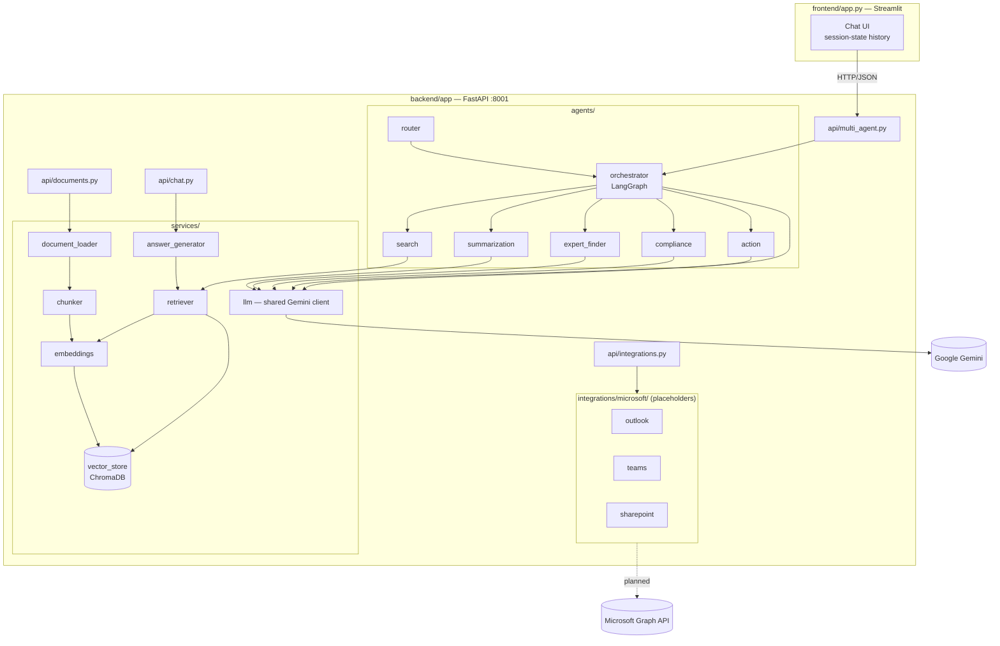
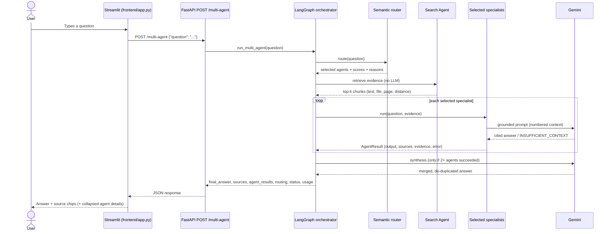
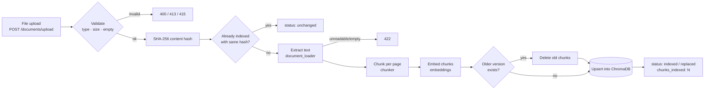
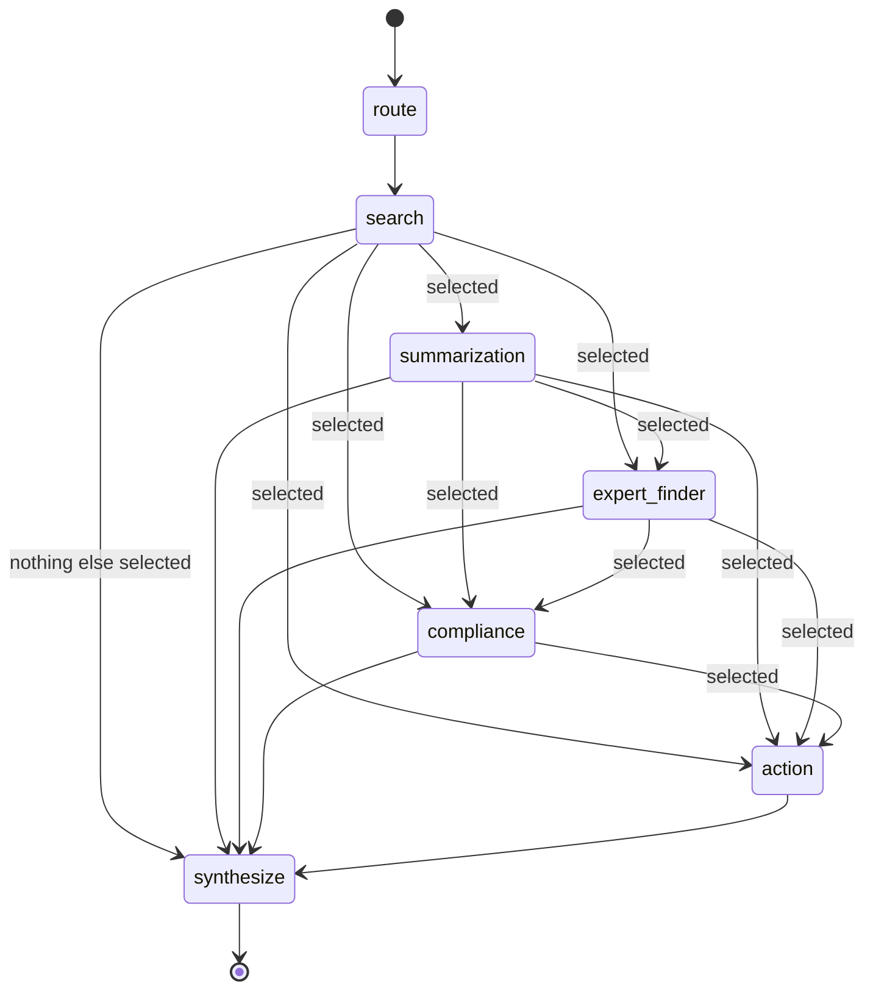
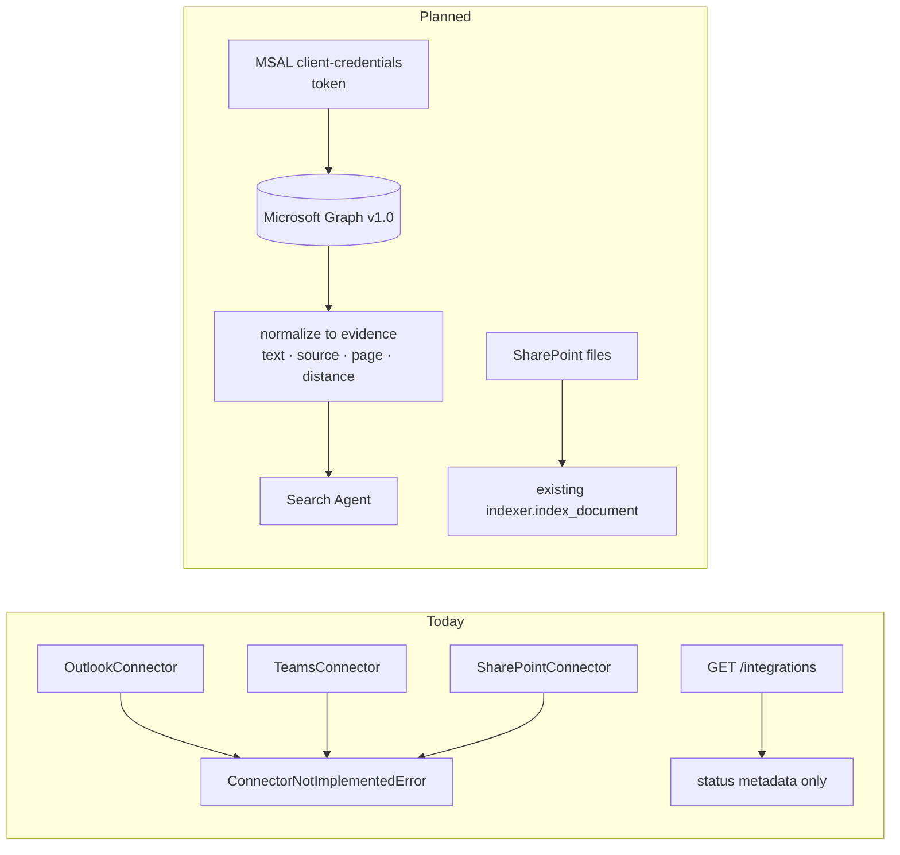

# Architecture — Enterprise Intelligent Knowledge Assistant

This document explains how a question travels through the system, how documents become searchable
knowledge, and how the five agents cooperate. File paths are relative to the repository root.

---

## 1. Components at a glance

| Layer | Responsibility | Key files |
|---|---|---|
| Frontend | Chat interface, history, rendering answers and sources | `frontend/app.py` |
| API | HTTP endpoints, validation, error mapping | `backend/app/api/*.py`, `schemas.py` |
| Services | RAG building blocks, shared by everything | `backend/app/services/*.py` |
| Agents | Five specialists, semantic router, LangGraph orchestrator | `backend/app/agents/*.py` |
| Integrations | Microsoft Graph connector interfaces (not active) | `backend/app/integrations/microsoft/*.py` |
| Configuration | Environment-driven settings | `backend/app/config.py`, `.env.example` files |

---

## 2. User question flow

---

## 3. Streamlit ↔ FastAPI communication

- The frontend talks to the backend **only over HTTP** using `requests`
  (`BACKEND_URL`, default `http://127.0.0.1:8001`).
- Every chat message is sent to `POST /multi-agent` with body `{"question": "..."}`. The frontend
  never selects agents.
- Timeouts: 5 s to connect, 180 s to read (Gemini calls plus retries).
- Errors are translated into friendly chat messages (backend offline, timeout, 422 invalid input,
  502/503 AI service unavailable). No tracebacks are shown.
- The **Gemini key and Microsoft credentials never reach the frontend.** The frontend reads only
  `frontend/.env` (`BACKEND_URL`); secrets stay in `backend/.env`.
- CORS on the backend allows configured browser origins (`CORS_ORIGINS`) for other future clients.

---

## 4. Document ingestion

Orchestrated by `backend/app/services/indexer.py`. Parsing and chunking happen **before** any
deletion, so a corrupt re-upload never destroys the previously indexed version.

### 4.1 Text extraction (`services/document_loader.py`)

| Format | Library | Page numbers |
|---|---|---|
| PDF | `pypdf` (page by page) | Yes |
| DOCX | `python-docx` (paragraphs + tables) | No (`null`) |
| TXT | built-in (UTF-8, Latin-1 fallback) | No (`null`) |

### 4.2 Chunking (`services/chunker.py`) — fixed-size with overlap

- `CHUNK_SIZE = 1000` characters, `CHUNK_OVERLAP = 200` characters (configurable).
- The chunk end moves back to the last whitespace, and the next chunk's start moves forward to a word
  boundary, so words are never split.
- Chunking is done **per page**; a chunk never mixes two pages, so citations are exact.
- Each chunk carries `source` (filename), `page` and `chunk_index`.

### 4.3 Embedding generation (`services/embeddings.py`)

- Model: `sentence-transformers/all-MiniLM-L6-v2` (384 dimensions), configurable via `EMBEDDING_MODEL`.
- Loaded **once per process** (cached) and reused for documents, questions and agent routing.
- Vectors are L2-normalized, so cosine similarity is a simple dot product.

### 4.4 ChromaDB vector storage (`services/vector_store.py`)

- `chromadb.PersistentClient` at `CHROMA_PERSIST_DIR` (default `backend/chroma_data/`, git-ignored).
- Collection uses `hnsw:space = cosine`.
- Stored per chunk: id `filename::chunk_index`, text, embedding, metadata
  `{source, page, chunk_index, content_hash}`.
- Data survives restarts; tests always use temporary directories.

---

## 5. Semantic retrieval (`services/retriever.py`)

1. Embed the question with the same model used for the documents.
2. Query ChromaDB for the `top_k` nearest chunks (default 3, max 20).
3. Drop chunks with cosine distance > `RETRIEVAL_MAX_DISTANCE` (0.9) as irrelevant.
4. Return `[{text, source, page, distance}]`, closest first. An empty database returns `[]`.

Matching is by meaning: "*Why did employees lose access to the order system?*" retrieves the passage
about an "*expired TLS certificate on an internal load balancer*" even though no keywords overlap.

---

## 6. Gemini response generation (`services/llm.py`, `services/answer_generator.py`)

- **One shared client** (`LLMClient`, official `google-genai` SDK) is used by `/chat`, all four LLM
  agents and the synthesis step. Model, temperature (0.1), output cap (1,024 tokens) and timeout come
  from configuration.
- **Grounded prompt:** passages are numbered `[1] (source: file, page N)`; the system instruction
  requires using only that context, citing passage numbers, and replying with `INSUFFICIENT_CONTEXT`
  when the answer is missing.
- **Errors:** placeholder/missing key or model → 503 before any network call; temporary 429/503/504
  → up to 2 retries with exponential backoff (1 s, 2 s); permanent errors (invalid key/model) fail
  immediately with a message naming the setting to fix. A failure is **never** replaced with an
  invented answer.
- **Token efficiency:** retrieval and routing never call Gemini; single-agent questions use exactly
  one Gemini call; prompts carry at most `top_k + 2` de-duplicated chunks; per-request usage is
  reported in the response.

---

## 7. Five-agent orchestration (`agents/`)

### 7.1 Agents

| Agent | Input | Extra retrieval | Output |
|---|---|---|---|
| Search (`search_agent.py`) | question | — | evidence chunks (no LLM) |
| Summarization (`summarization_agent.py`) | question + evidence | — | cited bullet summary of the requested topic |
| Expert Finder (`expert_finder_agent.py`) | question + evidence | people/roles/contacts-oriented query | people named in documents, roles, relevance, contacts if present |
| Compliance Checker (`compliance_agent.py`) | question + evidence | policy-oriented query | applicable requirements + assessment + disclaimer |
| Action (`action_agent.py`) | question + evidence + other agents' findings | — | actions with owner/deadline only if stated |

All LLM agents use the same helper (`common.run_grounded_llm`), which handles empty evidence,
Gemini errors and the insufficient-context marker uniformly.

### 7.2 Semantic routing (`agents/router.py`)

- Each agent has 5–9 **capability prototypes** (example requests), embedded once.
- The question **and each clause** (split on `?`, `;`, `and`, `also`) are compared to all prototypes;
  an agent's score is its best cosine similarity.
- Per clause, a specialist is selected if `score ≥ ROUTING_THRESHOLD (0.35)` and
  `score ≥ best − ROUTING_MARGIN (0.08)`; selections are unioned across clauses (multi-intent support).
- If nothing qualifies → **Search only** (`fallback_to_search: true`).
- The response returns every agent's score, selection and a human-readable reason.

### 7.3 LangGraph graph (`agents/orchestrator.py`)

Specialists run in a fixed order (Action last). A conditional edge after each node picks the next
selected agent that hasn't run yet.

---

## 8. Final answer synthesis

| Situation | Final answer | Gemini calls for synthesis |
|---|---|---|
| Search only (fallback) | Gemini answers directly from the retrieved evidence | 1 |
| Exactly one specialist succeeded | That agent's answer is used as-is | 0 |
| Two or more succeeded | One merge call; agents' citations are remapped to a shared passage list and only **cited** passages are re-sent; instructions require stating each fact once | 1 |
| Synthesis call fails | Agents' real outputs joined, repeated lines removed (`status: partial`) | — |
| All specialists failed | Explicit failure message with the Gemini error (`status: failed`) | 0 |
| Documents lack the answer | "The available documents do not contain enough information…" plus what is missing | — |

Status reporting: `success` is true only if every selected agent **and** synthesis succeeded;
`partial_success` is true when an answer was produced but some step failed.

---

## 9. Source citation flow

1. Retrieval attaches `source` and `page` metadata to every chunk.
2. Prompts number the chunks `[1]…[n]` and show their file and page.
3. Gemini cites the passage numbers it used.
4. `extract_citations` maps those numbers back to chunks; `unique_sources` de-duplicates
   `(filename, page)` pairs. If the model cites nothing, all supplied chunks are listed.
5. During synthesis, each agent's citations are **remapped** to the merged passage list so the final
   answer's numbers stay consistent.
6. The API returns `sources: [{filename, page}]`; the chatbot shows them as chips
   (e.g. `📄 Enterprise Knowledge Dataset.pdf · p.5`) and the full evidence in a collapsed panel.

---

## 10. Planned Microsoft Graph API integration

> **Status: prepared placeholders only.** No authentication, no Graph requests, no Microsoft data in
> answers. `GET /integrations` always reports `authenticated: false` and `live_data_enabled: false`.

- **Configuration** (`integrations/microsoft/config.py`): `MICROSOFT_CLIENT_ID`,
  `MICROSOFT_CLIENT_SECRET` (SecretStr, never returned), `MICROSOFT_TENANT_ID`,
  `MICROSOFT_GRAPH_BASE_URL` (default `https://graph.microsoft.com/v1.0`). All optional.
- **Interface** (`integrations/microsoft/base.py`): `GraphConnector.info()` for status and
  `search(query, top)` as the future Search Agent hook, returning retriever-shaped dicts so results can
  be merged with ChromaDB evidence without changing the agents.

| Connector | Planned Graph endpoints | Application permissions |
|---|---|---|
| Outlook | `GET /users/{id}/messages?$search=…`, `/messages/{id}` | `Mail.Read`, `User.Read.All` |
| Teams | `GET /teams/{id}/channels`, `/channels/{id}/messages`, `/replies` | `Team.ReadBasic.All`, `Channel.ReadBasic.All`, `ChannelMessage.Read.All` (protected API — needs Microsoft approval) |
| SharePoint | `POST /search/query` (driveItem), `/sites/{id}/drive/root/children`, `/drives/{id}/items/{id}/content` | `Sites.Read.All` (or `Sites.Selected`), `Files.Read.All` |

**Activation steps (future):** register an Entra ID app → grant admin consent → store credentials in
`backend/.env` → implement MSAL token acquisition → implement the Graph calls → add connector results
to the Search Agent behind a feature flag. SharePoint documents would be indexed through the
**existing** ingestion pipeline, not a second RAG pipeline.

---

## 11. Security notes

- Secrets live only in `backend/.env` (git-ignored); `.env.example` files contain placeholders.
- API responses never include the Gemini key or Microsoft credentials (`SecretStr`, booleans only).
- Unexpected server errors return a generic JSON message; details stay in server logs.
- Local ChromaDB data (`backend/chroma_data/`) is derived from your own documents and is not committed.
